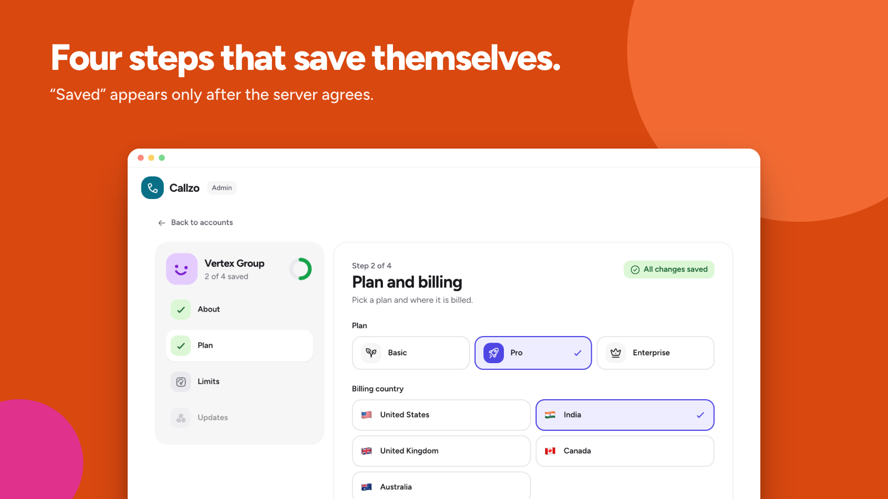
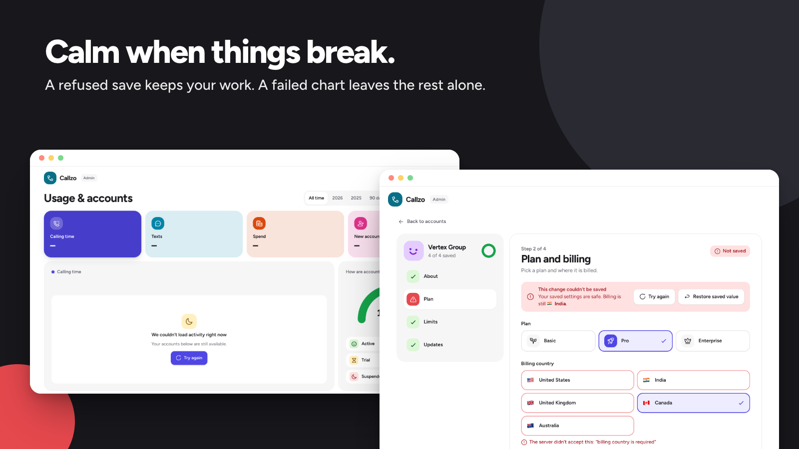

# Callzo

**A service that counts every call exactly once, and a console for the people who run the accounts.**

| | Task 1: Usage metering service | Task 2: Usage admin console |
|---|---|---|
| **Folder** | [`backend/`](backend/README.md) | [`frontend/`](frontend/README.md) |
| **What it does** | Receives signed call events, works out exact usage, watches the monthly cap, serves it through an API | Browse 10,500 accounts, read usage, edit settings that save themselves |
| **Built with** | Python, FastAPI, PostgreSQL, nginx | React, Tailwind, Recharts. Nothing else at runtime |
| **Tests** | 568, against real Postgres | 15 unit tests, plus 53 checks in real Chrome |
| **Open it** | [localhost:8000](http://localhost:8000) | [localhost:3000](http://localhost:3000) |

[Run it](#run-it) · [Architecture](#architecture) · [Tour](#a-five-minute-tour) · [What you asked for](#what-you-asked-for-and-where-it-is) · [How you score](#how-you-score-it-and-where-to-look) · [Problems](#problems-we-hit) · [Trade-offs](#what-was-given-up)

## Run it

You need Docker. From this folder:

```bash
docker build -t callzo-task2-frontend:1.0.0 frontend   # once, see the note
docker compose up
```

| Address | What opens |
|---|---|
| [localhost:8000](http://localhost:8000) | Task 1 console. No sign-in on localhost |
| [localhost:8000/docs](http://localhost:8000/docs) | Task 1 API reference |
| [localhost:3000](http://localhost:3000) | Task 2 console |
| [localhost:8001/health](http://localhost:8001/health) | Callzo's mock API |

Each task also runs alone with `docker compose up` inside its own folder. Stop the root stack first, because they share ports. Nothing needs a `.env` file.

> **The note.** Task 2's compose file uses `image:` and never `build:`, as the spec asks. The image is not on a public registry yet, so the first command builds it locally under the same name. It builds for both x86 and ARM. Callzo's own two images are ARM only, so an x86 machine runs those two through emulation.

## Architecture


The tasks share a repository and a look. They do not share code, data or a network, because the brief tests them separately.

**Task 1 in one sentence:** store the event first, answer second, and let a worker add *the difference* between what a call should count for and what it already counted for. That is why a duplicate, a late event, a wrong order or a crash cannot change a total twice.

**Task 2 in one sentence:** what you typed, what the server confirmed and what you selected are three separate things, so a refresh or a failed save can never mix them up.

| In close-up | |
|---|---|
|  |  |

## What it looks like

| Task 1 | Task 2 |
|---|---|
|  |  |
|  |  |
|  |  |
|  |  |

These are screenshots of the running apps, framed.

## A five-minute tour

| # | Do this | Look for |
|---|---|---|
| 1 | Open [localhost:8000](http://localhost:8000), press **Run all 8** | Duplicates, wrong order, late, broken and forged traffic. Each scenario judges itself |
| 2 | Open **Accounts**, then `acct_001` | The simulator's burst took it past its cap: **No new calls**, with the moment it crossed |
| 3 | Run `docker kill callzo-api-1`, then press **Run all 8** again | Still works. nginx uses the other server. Bring it back with `docker compose up -d` |
| 4 | Open [localhost:3000](http://localhost:3000), tick rows, change page, wait 15 s | Numbers flash, rows hold still, ticks stay |
| 5 | Reload until the chart fails (about 1 in 5) | Only the chart shows an error. The table carries on |
| 6 | Open an account, **Manage settings**, finish all four steps, go back to **Plan**, change the country | The refusal lands on step 2. **Restore saved value** gets you out. Nothing else is lost |

## What you asked for, and where it is

### Task 1

| You asked for | Answer | Where |
|---|---|---|
| Signed webhooks, refused before processing | HMAC-SHA256 over the raw bytes, constant-time compare, then parsing. `401` | [`verification.py`](backend/app/modules/webhooks/verification.py) |
| Duplicate, late and out-of-order events | Unique event ID. State decided from all of a call's events, whatever the order. Late events count in the month they happened and are flagged | [`call_state.py`](backend/app/modules/metering/call_state.py) |
| Postgres schema you can justify | Four core tables, each with one job | [Data model](backend/README.md#data-model) |
| Integer money | `cost_cents` and seconds, `bigint`, end to end | [`001_init.sql`](backend/migrations/001_init.sql) |
| Transactions where correctness depends on them | Usage change and "done" mark share one commit | [`worker.py`](backend/app/modules/metering/worker.py) |
| Monthly cap, soft or hard, boundary documented | **Soft.** Exactly at the cap counts as reached | [The cap](backend/README.md#the-monthly-cap) |
| Background job for retries | Workers with growing waits, 8 attempts, then set aside and visible | [`retry_policy.py`](backend/app/modules/inbox/retry_policy.py) |
| Reconciliation from raw events | Hourly check, and a command that repairs | [`reconcile/`](backend/app/modules/reconcile/service.py) |
| API authentication | Bearer keys: one for reading, one for admin. Rotation without downtime | [`security.py`](backend/app/core/security.py) |
| Validate all input, no secrets in code | Strict types. The app refuses to start without its secrets | [`schemas.py`](backend/app/modules/webhooks/schemas.py), [`config.py`](backend/app/core/config.py) |
| Structured logs, a metric or health check | JSON logs with request IDs, `/metrics`, `/health/live`, `/health/ready` | [API](backend/README.md#api) |
| `docker compose up`, Dockerfile, tests | All in `backend/` | [Run it](backend/README.md#run-it) |
| README: setup, decisions, failures, next | One section each | [backend/README.md](backend/README.md) |

### Task 2

| You asked for | Answer | Where |
|---|---|---|
| React, Tailwind, one chart library, nothing else | Three runtime packages: `react`, `react-dom`, `recharts` | [`package.json`](frontend/package.json) |
| Server-side search, sort and filters | Every control is a query to the API | [`query.ts`](frontend/src/lib/query.ts) |
| Selection stable across pages | A set of IDs, kept above the table and through reloads | [`selection.ts`](frontend/src/lib/selection.ts) |
| Dates drive table and chart, no reload | One range in the URL feeds both. Click a bar to zoom | [`PeriodPicker.tsx`](frontend/src/accounts/PeriodPicker.tsx) |
| 4-step form: autosave, go back, errors on their own step | One state machine per step | [`reducer.ts`](frontend/src/settings/reducer.ts) |
| Loading, empty, error and partial failure everywhere | Each view loads and fails alone | [States](frontend/README.md#every-state-designed) |
| Failed saves roll back cleanly | "Saved" only ever means the server said so. Your text stays, marked *Not saved*, with one button to roll back | [`useSettings.ts`](frontend/src/settings/useSettings.ts) |
| Keyboard, labels, focus | Native controls. Focus returns to the row you came from | [Keyboard](frontend/README.md#keyboard-focus-and-small-screens) |
| Usable at 375px | A separate layout, checked for overflow | [Keyboard](frontend/README.md#keyboard-focus-and-small-screens) |
| Refresh without jumping | Values update in place; a new order waits for you | [`mergeRefresh.ts`](frontend/src/lib/mergeRefresh.ts) |
| The two deliberate faults | Chart: one quiet retry, then a button. Step 2: prevented where possible, explained where not | [The step 2 trap](frontend/README.md#the-step-2-trap) |
| Note: where state lives. Note: what was cut | Both | [State](frontend/README.md#where-state-lives-and-why), [Cut](frontend/README.md#what-was-cut-and-why) |

## How you score it, and where to look

| You score | Start here |
|---|---|
| **Clarifies before building** | [Questions](#questions-and-assumptions), then the assumptions in each README |
| **Handles failure cases** | The red boxes in [this diagram](backend/docs/architecture.png), and [failure behaviour](backend/README.md#when-things-break) |
| **Explains trade-offs** | [What was given up](#what-was-given-up), with a fuller table in each README |
| **Holds up under change** | "If you change the requirement": [backend](backend/README.md#if-you-change-the-requirement), [frontend](frontend/README.md#if-you-change-the-requirement) |
| **Taste and simplicity** | No queue server, ORM, router, state or form library. The hard parts are small pure functions: [`call_state.py`](backend/app/modules/metering/call_state.py), [`buckets.py`](backend/app/modules/aggregates/buckets.py), [`mergeRefresh.ts`](frontend/src/lib/mergeRefresh.ts) |
| **Code quality** | One folder per feature, all SQL in repositories, lint and format checked in [CI](.github/workflows/backend.yml) |
| **Documentation** | This page, then one README per task |
| **Runs cleanly in Docker** | One command per task. Checked from a clean copy with empty databases |

## Questions and assumptions

These were unclear, so each has a stated answer that is easy to change.

| Question | Assumed until told otherwise |
|---|---|
| Can the service stop a call, or only report? | Only report. It hears about calls after they happen, so it answers "are new calls allowed?" |
| Is the cap in minutes or money? | Minutes, like `minutes_cap` in your own settings form. Default 200 |
| Which month does a late call belong to? | The UTC month it happened in. It is flagged, and never uses up this month's cap |
| Whose midnight ends a month? | UTC |
| Two different endings for one call? | `ended` beats `failed`, then the later time, then the larger event ID |
| Same event ID, different content? | The first one stands. The second gets `409` |
| Which currency? | None is named, so amounts show no symbol |
| Does "no other library" cover build tools? | No. Vite and TypeScript build the app; only React and Recharts ship in it |
| Does "roll back" mean erase what I typed? | No. The *saved* value rolls back. Your text stays until you choose |

## Problems we hit

The ones that taught us something. Each task's README has the rest.

| Problem | How it showed up | What fixed it |
|---|---|---|
| **Workers deadlocked** | Claiming ten events at a time: 47 deadlocks in one run | Claim one. Always lock in the same order: account, call, totals |
| **Corrections were refused forever** | Postgres tests a `CHECK` on the row you *propose*, and a correction proposes −1 | A trigger that checks the *final* row |
| **A test that could not fail** | The locking test still passed after the lock was removed | Rewrote it so only the lock can make it pass, and proved it fails without |
| **The notification made it slower** | `NOTIFY` queues commits behind one another: about 4,000 inserts a second became 1,400 to 1,900 | Workers check a tiny index every 0.2 s instead |
| **Overload lost calls** | One API server, 12,000 calls: 8 deliveries ended in `503`, three accounts a call short | Two servers, nginx retries the other, a bounded queue, senders that resend |
| **A dead end in the form** | Submitting sent steps in parallel. Step 4 landed first, and step 2 was refused for good | Step 4 always waits for steps 1 to 3 |
| **Half the countries were missing** | The filter reused the billing list of five. The data has ten | Two lists, for two jobs |
| **The page slid sideways on phones** | A custom date range was 3px too wide at 375px | Caught by an automatic overflow check, then fixed |
| **A colour palette that failed** | Pink and green looked the same to some colour-blind users | New palette, checked, and nothing relies on colour alone |

## What was given up

| Chose | Instead of | The price |
|---|---|---|
| Postgres as the queue | Kafka, Redis, Celery | A ceiling on throughput. In return: one system to run, one transaction to trust |
| Soft cap | Hard cap | Calls already running can overshoot. A hard cap needs a reservation in the dialer |
| Adding differences to four totals | Summing a month on every event | A busy account's workers briefly queue behind each other |
| Plain SQL | An ORM | More SQL to read, in plain sight |
| Rows that hold still | A live re-sort | The order can be a little out of date, and says so |
| Own small hooks | Query, router and form libraries | Their edge cases became ours, so they are tested |
| A console, audit log and fleet view in Task 1 | Only what the brief lists | More code to own. None of it decides what gets counted |
