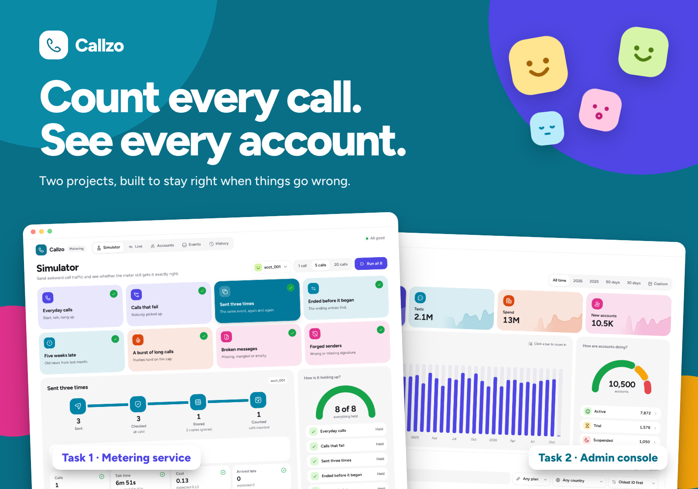
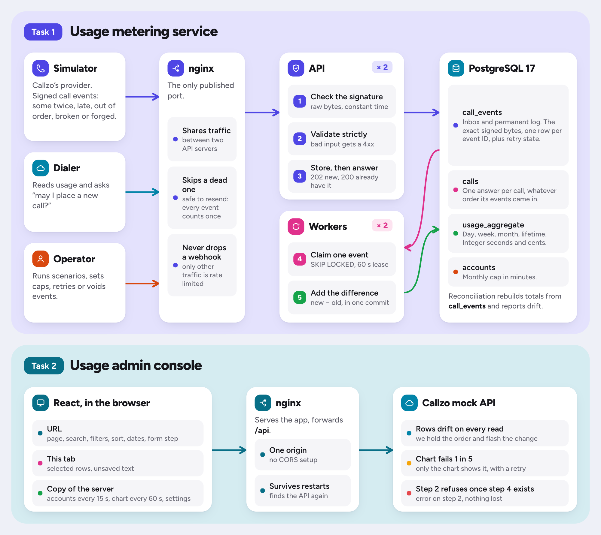
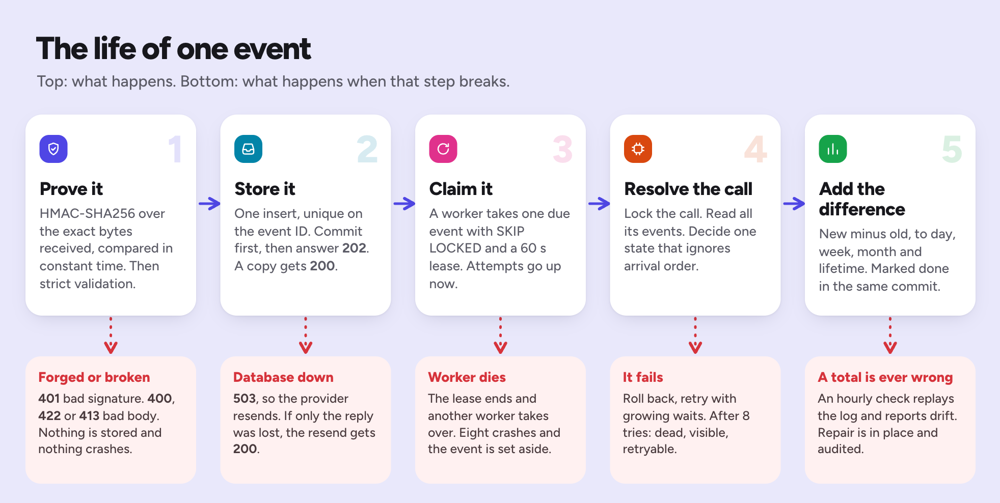
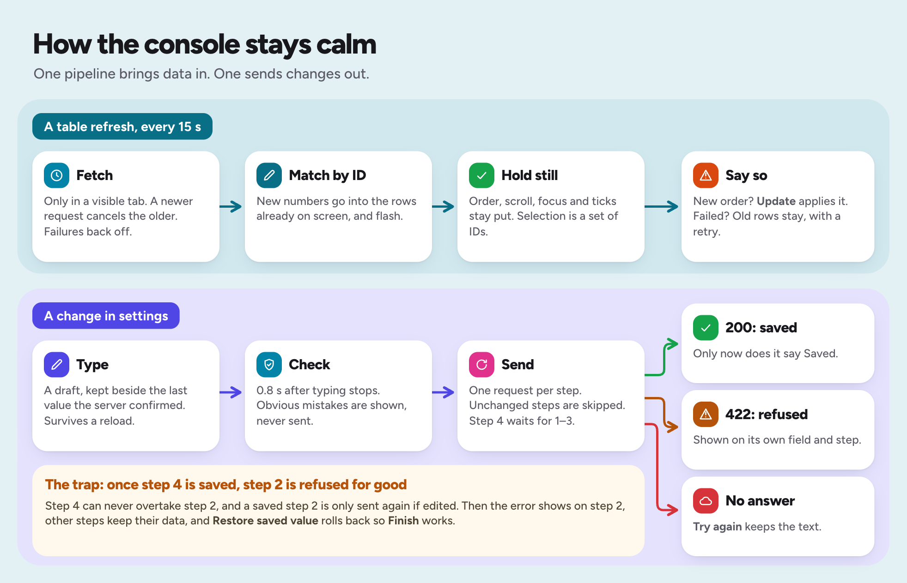
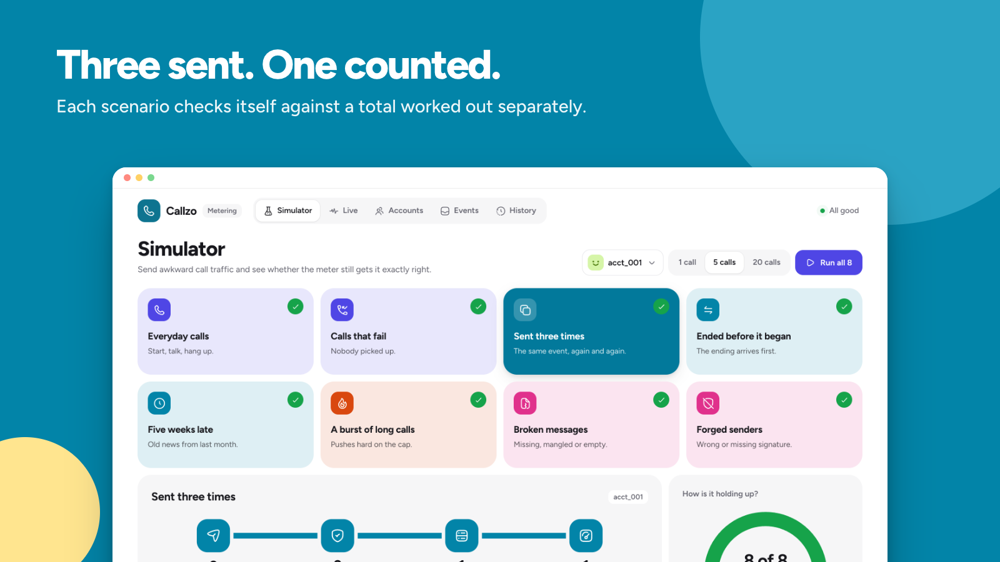
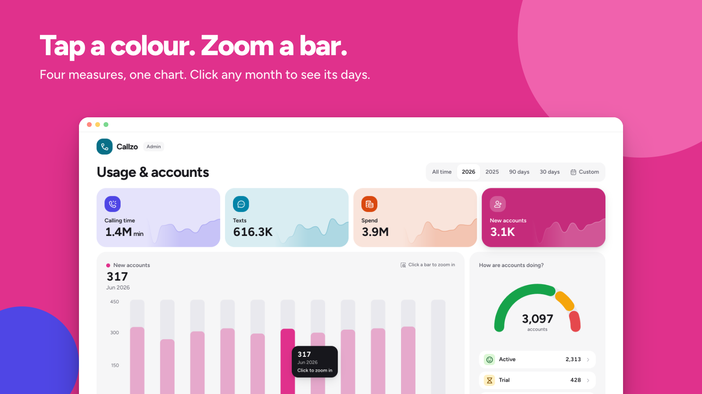
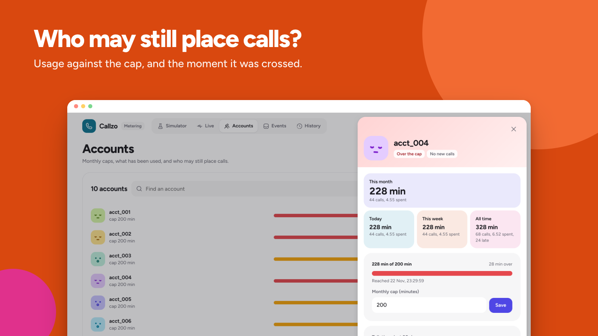
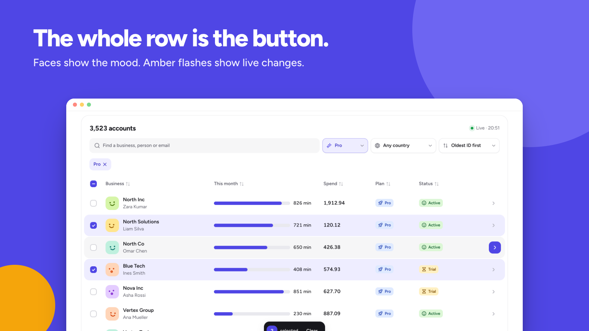
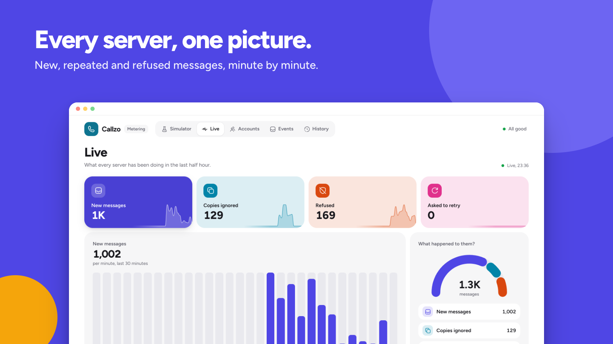
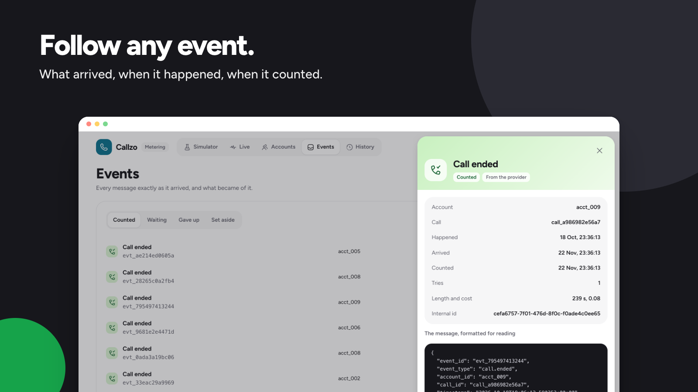

# Callzo

**A service that counts every call exactly once, and a console for the people who run the accounts.**

| | Task 1: Usage metering service | Task 2: Usage admin console |
|---|---|---|
| **Folder** | [`backend/`](backend/README.md) | [`frontend/`](frontend/README.md) |
| **What it does** | Receives signed call events, works out exact usage, watches the monthly cap, serves it through an API | Browse 10,500 accounts, read usage, edit settings that save themselves |
| **Built with** | Python, FastAPI, PostgreSQL, nginx | React, Tailwind, Recharts. Nothing else at runtime |
| **Tests** | 570, against real Postgres | 15 unit tests, plus 53 checks in real Chrome |
| **Open it** | [localhost:8000](http://localhost:8000) | [localhost:3000](http://localhost:3000) |

[Run it](#run-it) · [Architecture](#architecture) · [Files and Logics](#files-and-logics) · [Problems](#problems-we-hit)

## Run it

You need Docker. From this folder:

```bash
docker compose up
```

| Address | What opens |
|---|---|
| [localhost:8000](http://localhost:8000) | Task 1 console. No sign-in on localhost |
| [localhost:8000/docs](http://localhost:8000/docs) | Task 1 API reference |
| [localhost:3000](http://localhost:3000) | Task 2 console |
| [localhost:8001/health](http://localhost:8001/health) | Callzo's mock API |

Each task also runs alone with `docker compose up` inside its own folder. Stop the root stack first, because they share ports. Nothing needs a `.env` file.

Task 2 runs a published image, [`avnisinghal01/callzo-task2-frontend:1.0.0`](https://hub.docker.com/r/avnisinghal01/callzo-task2-frontend), through `image:` and never `build:`, as the spec asks. It supports x86 and ARM. Callzo's own two images are ARM only, so an x86 machine runs those two through emulation.

## Architecture



The tasks share a repository and a look. They do not share code, data or a network, because the brief tests them separately.

| In close-up | |
|---|---|
|  |  |

## What it looks like

| Task 1 | Task 2 |
|---|---|
|  |  |
|  |  |
|  |  |
|  |  |

These are screenshots of the running apps, framed.

## Files and Logics

### Task 1

| Concepts covered | Answer | Where |
|---|---|---|
| Signed webhooks, refused before processing | HMAC-SHA256 over the raw bytes, constant-time compare, then parsing. `401` | [`verification.py`](backend/app/modules/webhooks/verification.py) |
| Duplicate, late and out-of-order events | Unique event ID. State decided from all of a call's events, whatever the order. Late events count in the month they happened and are flagged | [`call_state.py`](backend/app/modules/metering/call_state.py) |
| Postgres schema you can justify | Four core tables, each with one job | [Data model](backend/README.md#data-model) |
| Integer money | Whole cents and whole seconds everywhere. Totals are `bigint` | [`001_init.sql`](backend/migrations/001_init.sql) |
| Transactions where correctness depends on them | Usage change and "done" mark share one commit | [`worker.py`](backend/app/modules/metering/worker.py) |
| Monthly cap, soft or hard, boundary documented | **Soft.** Exactly at the cap counts as reached | [The cap](backend/README.md#the-monthly-cap) |
| Background job for retries | Workers with growing waits, 8 attempts, then set aside and visible | [`retry_policy.py`](backend/app/modules/inbox/retry_policy.py) |
| Reconciliation from raw events | Hourly check, and a command that repairs | [`reconcile/`](backend/app/modules/reconcile/service.py) |
| API authentication | Bearer keys: one for reading, one for admin. Rotation without downtime | [`security.py`](backend/app/core/security.py) |
| Validate all input, no secrets in code | Strict types. The app refuses to start without its secrets | [`schemas.py`](backend/app/modules/webhooks/schemas.py), [`config.py`](backend/app/core/config.py) |
| Structured logs, a metric or health check | JSON logs with request IDs, `/metrics`, `/health/live`, `/health/ready` | [API](backend/README.md#api) |
| `docker compose up`, Dockerfile, tests | All in `backend/` | [Run it](backend/README.md#run-it) |
| README: setup, decisions, failures, next | One section each | [backend/README.md](backend/README.md) |

### Task 2

| Concepts covered | Answer | Where |
|---|---|---|
| React, Tailwind, one chart library, nothing else | Three runtime packages: `react`, `react-dom`, `recharts` | [`package.json`](frontend/package.json) |
| Server-side search, sort and filters | Every control is a query to the API | [`query.ts`](frontend/src/lib/query.ts) |
| Selection stable across pages | A set of IDs, kept above the table and through reloads | [`selection.ts`](frontend/src/lib/selection.ts) |
| Dates drive table and chart, no reload | One range in the URL feeds both. Click a bar to zoom | [`PeriodPicker.tsx`](frontend/src/accounts/PeriodPicker.tsx) |
| 4-step form: autosave, go back, errors on their own step | One state machine per step | [`reducer.ts`](frontend/src/settings/reducer.ts) |
| Loading, empty, error and partial failure everywhere | Each view loads and fails alone | [States](frontend/README.md#every-state-designed) |
| Failed saves roll back cleanly | "Saved" only ever means the server said so. Your text stays, marked *Not saved*, with one button to roll back | [`useSettings.ts`](frontend/src/settings/useSettings.ts) |
| Keyboard, labels, focus | Native controls. Focus returns to the row you came from | [Keyboard](frontend/README.md#keyboard-focus-and-small-screens) |
| Usable at 375px | A separate layout, checked for overflow | [Keyboard](frontend/README.md#keyboard-focus-and-small-screens) |
| Refresh without jumping | Values update in place; a new order waits for you | [`mergeRefresh.ts`](frontend/src/lib/mergeRefresh.ts) |
| The two deliberate faults | Chart: one quiet retry, then a button. Step 2: prevented where possible, explained where not | [The step 2 trap](frontend/README.md#the-step-2-trap) |
| Note: where state lives. Note: what was cut | Both | [State](frontend/README.md#where-state-lives-and-why), [Cut](frontend/README.md#what-was-cut-and-why) |

## Problems we hit

The ones that taught us something. Each task's README has the rest.

| Problem | How it showed up | What fixed it |
|---|---|---|
| **A worker that looked alive and was not** | The hourly check left a transaction open. After that, every commit by that worker was silently undone, while its health check stayed green. Found when the console showed one worker awake instead of two | Transactions that cannot stay open, and a health check that only passes after a real commit. The old test missed it by checking on the same connection that did the work |
| **Workers deadlocked** | A prototype claiming ten events at a time: 47 deadlocks in one run | Claim one. Always lock in the same order: account, call, totals |
| **Corrections were refused forever** | Postgres tests a `CHECK` on the row you *propose*, and a correction proposes −1 | A trigger that checks the *final* row |
| **A test that could not fail** | The locking test still passed after the lock was removed | Rewrote it so only the lock can make it pass, and proved it fails without |
| **The notification made it slower** | `NOTIFY` queues commits behind one another: about 4,000 inserts a second became 1,400 to 1,900 | Workers check a tiny index every 0.2 s instead |
| **Overload lost calls** | One API server, 12,000 calls: 8 deliveries ended in `503`, three accounts a call short | Two servers, nginx retries the other, a bounded queue, senders that resend |
| **Killing a server broke the next page** | Docker forgot the dead server while nginx was still trying it, so nginx gave up with a `504` | One fresh try for anything safe to repeat. Five kills, 10,550 requests, no errors |
| **A dead end in the form** | Submitting sent steps in parallel. Step 4 landed first, and step 2 was refused for good | Step 4 always waits for steps 1 to 3 |
| **Half the countries were missing** | The filter reused the billing list of five. The data has ten | Two lists, for two jobs |
| **The page slid sideways on phones** | A custom date range was 3px too wide at 375px | Caught by an automatic overflow check, then fixed |
| **A chart that needed a mouse** | Zooming a bar had no key | Arrow keys move, Enter zooms |
| **A colour palette that failed** | Pink and green looked the same to some colour-blind users | New palette, checked, and nothing relies on colour alone |

