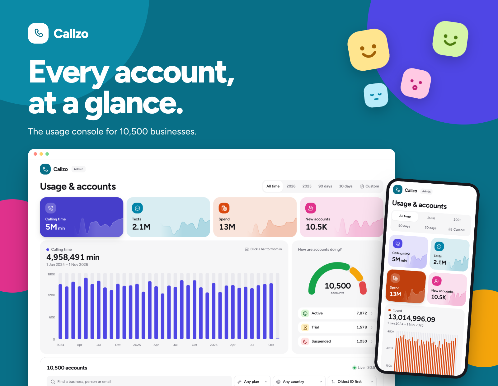
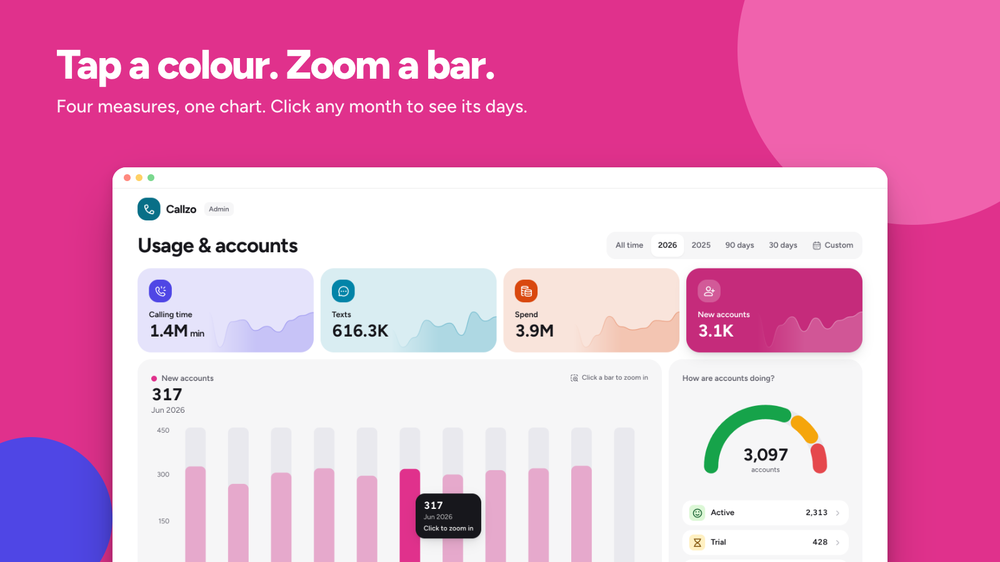
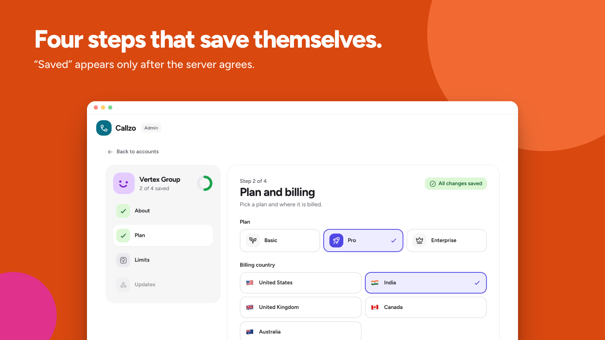
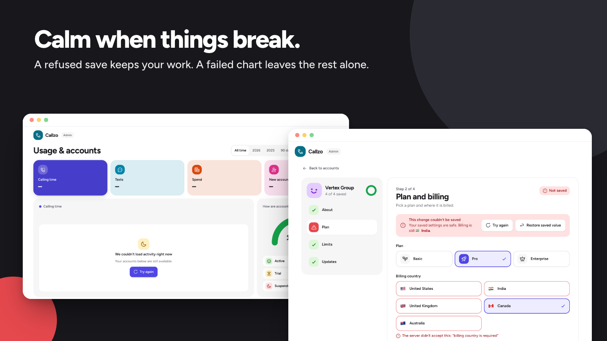

| | |
|---|---|
|  |  |
|  |  |
|  |  |

# Callzo · Usage & accounts

An admin console for 10,500 accounts. React, Tailwind and Recharts. No other runtime libraries.

## Run it

```bash
docker build -t callzo-task2-frontend:1.0.0 .   # until the image is on a public registry
docker compose up
```

Open **http://localhost:3000**. The mock API is on `:8001`.

<details>
<summary>Without Docker for the app (Node 22.18+)</summary>

```bash
docker compose up -d mock-api
npm ci
npm run dev      # http://localhost:5173
npm test         # 15 unit tests, Node's own runner
npm run build
```
</details>

## Features

| | |
|---|---|
| **Colour-coded measures** | Calling time, texts, spend and new accounts. Each keeps its colour everywhere |
| **Zoomable chart** | Days, weeks or months, whichever reads best. Click a bar to zoom the whole page |
| **Status gauge** | Live counts that double as the table's status filter |
| **Account table** | Server-side search, filters, sorting and paging. Click anywhere on a row |
| **Selection** | Kept by id across pages, sorting, refreshes and reloads |
| **Live refresh** | Every 15 s. Changed numbers flash; rows never move until you choose *Update* |
| **Details drawer** | Step to the next account without closing it |
| **Four-step settings** | Autosave, back navigation, draft recovery, errors on the step they belong to |
| **Every state designed** | Loading, empty, error and partial failure for each async view |
| **Keyboard and 375px** | Native controls, managed focus, reduced motion respected |

## Check it in five minutes

1. **Chart fails alone.** Reload a few times: about 1 summary call in 5 returns 500. One silent retry, then *Try again*. The table is unaffected.
2. **Refresh does not jump.** Sort by *Most calling*, tick rows, wait 15 s. Rows hold still and stay ticked.
3. **Selection survives.** Tick rows, change page, reload, go back.
4. **Dates drive both.** Click a chart bar. The chart, counts and table all follow.
5. **The step 2 trap.** Finish all four steps, return to *Plan* and change the country. The error lands on that field, other steps are untouched, *Restore saved value* clears it, and *Finish* works.
6. **Failed save.** Run `docker stop mock-api` and edit a field. Your text stays and is marked *Not saved*. Reload after `docker start mock-api` and it is restored.
7. **Keyboard.** Tab to a business name, `Enter` to open, `Esc` to return to the same row.

`docker start mock-api` after a stop resets the mock's saved settings, so it comes back empty.

## Where state lives, and why

| State | Home | Why |
|---|---|---|
| Page, search, filters, sort, dates, measure, open account, form step | URL | Survives reload, shareable, Back works |
| Accounts, summary, saved settings | Server; last good copy in memory | The server is the authority |
| Selected ids | Memory + `sessionStorage` | Independent of which rows are visible |
| Unsaved form edits | Reducer + `sessionStorage` | A reload must not lose text the server refused |
| Open menus, hover | Component | Nobody else needs it |

**Settings.** Each step keeps `saved` (last server-confirmed), `draft` (typed) and `status` apart, so an unsaved value can never look saved. One request per step at a time; edits made meanwhile become one follow-up.

**The step 2 quirk.** Once the API holds step 4 it refuses step 2. So unchanged steps are never re-sent, and step 4 always waits for steps 1 to 3, even mid-save. Otherwise an account could become impossible to finish.

**Networking.** Browsers cannot resolve `mock-api`, so nginx serves the app and forwards `/api` to `API_URL`. One origin, no CORS.

## Assumptions

- The spec names no currency, so spend is `cost_cents / 100` without a symbol.
- Dates mean *activity* for the chart and *signup* for accounts. The date picker says so.
- The API accepts negative caps; the form does not.
- The API has no list of countries. The filter offers the ten found in the data.
- The gauge uses three one-row `/accounts` requests, because no counts endpoint exists.
- Faded bars are partial weeks or months.

## Left out, on purpose

- **Bulk actions:** the API has none, so selection stops at selecting.
- **Dark mode, sign-in, export:** not in the brief.
- **Router, state, table, form, icon and animation libraries:** not allowed, and not needed. Icon paths are vendored.
- **Percentage changes:** the API has no comparison period to base them on.

Credits: [THIRD_PARTY.md](THIRD_PARTY.md)
