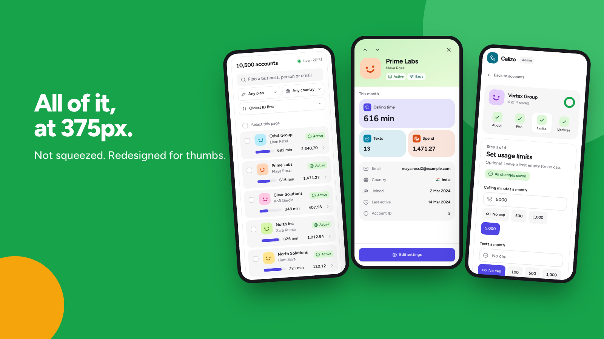

# Task 2: Usage admin console

Find any of 10,500 accounts, see how they use the service, and change their settings without worrying whether the change was saved.

React, Tailwind and Recharts. No other library ships to the browser.

[Run it](#run-it) · [Architecture](#architecture) · [States](#every-state-designed) · [Problems](#problems-we-hit)

## Run it

From this folder, with Docker running:

```bash
docker compose up
```

Open [localhost:3000](http://localhost:3000). The mock API is on [localhost:8001](http://localhost:8001/health).

The compose file pulls [`avnisinghal01/callzo-task2-frontend:1.0.0`](https://hub.docker.com/r/avnisinghal01/callzo-task2-frontend), for x86 and ARM. It uses `image:` and never `build:`, as your spec asks.

<details>
<summary>Develop without Docker for the app (Node 22.18 or newer)</summary>

```bash
docker compose up -d mock-api
npm ci
npm run dev      # http://localhost:5173
npm test         # 15 unit tests, with Node's own runner
npm run build    # type check and production build
```

</details>

## Architecture


A browser cannot find a container called `mock-api`, so nginx serves the app and passes `/api` on to `API_URL`. One address, no CORS. The development server does the same. The container runs without root, with a read-only disk.

## What it looks like

| | |
|---|---|
|  |  |
|  |  |
|  |  |

### "Failed saves must roll back cleanly"

When a save fails, the record of what is saved stays at the last confirmed value, so nothing false is shown. What you typed is **not** thrown away. It stays, marked *Not saved*, with **Try again** and **Restore saved value**. Wiping someone's typing looks clean and feels awful.

- One request per step at a time. Edits made meanwhile become one follow-up, so an old answer can never overwrite newer text.
- A step that has not changed is never sent again.

## Every state, designed

| View | Loading | Empty | Error | Partial failure |
|---|---|---|---|---|
| Account table | Placeholder rows | Says why, with **Clear filters** or **Show all time** | Message and retry | Refresh failed: old rows stay, with "Showing data from 14:05" |
| Chart and tiles | Placeholder | "No activity in this period" | Inline, with *Try again* | Fails alone. An older chart stays, with its time |
| Status gauge | Placeholder | Zero counts | Inline, with *Try again* | Fails alone. "Counts may be out of date" |
| Account details | Uses the row it came from | — | Retry, or "couldn't find this account" for a 404 | Refresh failed: last values stay |
| Settings | Placeholder | Starts from the account's own details | Retry, or not found | Each step has its own status. If only the account's name fails to load, the form still opens |

Polling pauses in hidden tabs, never overlaps, and waits longer after each failure. A newer request cancels the older one, so a slow answer cannot replace a fast one. The table refreshes every 15 s; the chart and gauge every 60 s.

## Tests

```bash
npm test
```

15 unit tests cover the parts that are easy to get wrong: refresh merging, selection, URL parsing, date buckets, API payloads, the step 2 trap, typing during a save, and recovery after a reload.

53 checks in real Chrome were run against the Docker image: chart failure and retry, refresh without jumping, stale answers, selection after reload, the whole settings flow including the trap, keyboard use, focus return, and 375px. They are not in the repository. **Not done:** a screen reader pass.

## Problems we hit

| Problem | Cause | Fix |
|---|---|---|
| Accounts that could never be finished | Submit sent the steps in parallel, and step 4 could land before step 2 | Save in order. Step 4 waits, even mid-save |
| Half the countries missing from the filter | It reused the five billing countries. The data has ten | Two lists |
| "Unfinished changes" stayed after saving | The notice was not tied to the save | It ends when the last recovered edit is confirmed |
| Page slid sideways on phones | 63px at first, then 3px with a custom date range | Fixed layout, and an overflow check on every screen |
| Screen readers would read a whole menu as its name | The label wrapped every option | A short label of its own |
| Zooming the chart needed a mouse | Only a click handler | Arrow keys move, Enter zooms |
| Focus could miss the first error | It looked before the errors were on screen | It waits until they are |
| The all-time chart was noise | A point per day for nearly three years | Days, weeks or months, whichever reads best |
| The headline and tooltip disagreed for a moment | The number was still counting up while hovering | Exact at once on hover |
| A missing account name blocked the whole form | Two requests treated as one | The name is optional. The form opens anyway |
| The proxy kept calling a dead address | nginx looks a name up once, at start | It looks again, so a restarted API is found |
| The component library could not be used | It needs React Aria, which the brief rules out | Adapted the parts with no dependencies, rebuilt the rest on native elements |
| Pink and green looked alike | Failed a colour-blindness check | New palette, and words beside colours |

## Code map

```text
src/api/       requests and types
src/hooks/     loading and polling, URL state, small UI hooks
src/lib/       pure functions: refresh merge, selection, dates, queries, formats
src/summary/   tiles, chart, status gauge
src/accounts/  table, paging, dates, details
src/settings/  model, reducer, save pipeline, form
src/ui/        buttons, fields, icons, faces
```