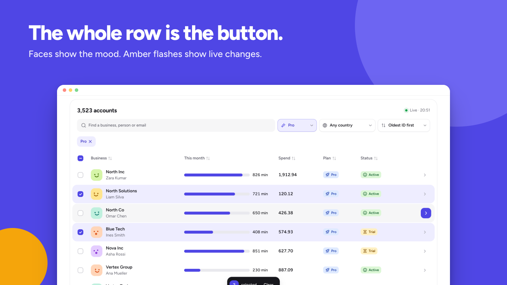
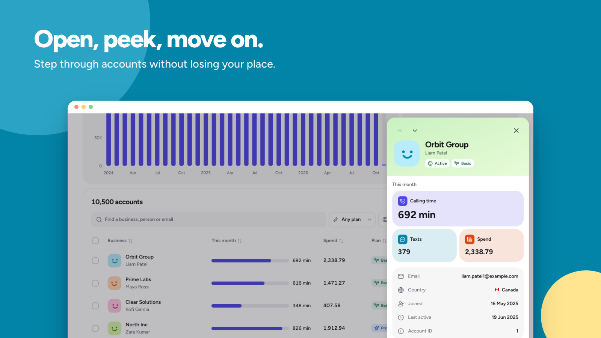

# Task 2: Usage admin console

Find any of 10,500 accounts, see how they use the service, and change their settings without worrying whether the change was saved.

React, Tailwind and Recharts. No other library ships to the browser.

[Run it](#run-it) · [Architecture](#architecture) · [Tour](#a-tour-of-the-hard-parts) · [State](#where-state-lives-and-why) · [The step 2 trap](#the-step-2-trap) · [States](#every-state-designed) · [Keyboard](#keyboard-focus-and-small-screens) · [Cut](#what-was-cut-and-why) · [Problems](#problems-we-hit)

## Run it

From this folder, with Docker running:

```bash
docker compose up
```

Open [localhost:3000](http://localhost:3000). The mock API is on [localhost:8001](http://localhost:8001/health).

The compose file pulls [`avnisinghal01/callzo-task2-frontend:1.0.0`](https://hub.docker.com/r/avnisinghal01/callzo-task2-frontend), for x86 and ARM. It uses `image:` and never `build:`, as your spec asks.

<details>
<summary>Develop without Docker for the app (Node 22.18 or newer)</summary>

```bash
docker compose up -d mock-api
npm ci
npm run dev      # http://localhost:5173
npm test         # 15 unit tests, with Node's own runner
npm run build    # type check and production build
```

</details>

## Architecture


A browser cannot find a container called `mock-api`, so nginx serves the app and passes `/api` on to `API_URL`. One address, no CORS. The development server does the same. The container runs without root, with a read-only disk.

## What it looks like

| | |
|---|---|
|  |  |
|  |  |
|  |  |

## A tour of the hard parts

| # | Do this | Look for |
|---|---|---|
| 1 | Search, sort, filter, change page | Every one is a request to the API. The URL changes, so Back and sharing work |
| 2 | Click a bar in the chart | Chart, counts and table all move to those dates, with no reload |
| 3 | Sort by *Most calling*, tick some rows, wait 15 s | Numbers flash. Rows do not move. If the order would change, **Update** appears |
| 4 | Tick rows, change page, reload, come back | Still ticked, with a count of those on other pages |
| 5 | Reload until the chart fails, about 1 in 5 | One quiet retry, then *Try again*. The table never notices |
| 6 | Open an account, **Edit settings**, type, then run `docker stop mock-api` and type again | *Not saved*, text kept. After `docker start mock-api`, reload and your text is back |
| 7 | Finish all four steps, return to **Plan**, change the country | [The trap](#the-step-2-trap), handled |
| 8 | Put the mouse away | [Everything works](#keyboard-focus-and-small-screens) |

`docker start mock-api` brings the mock back empty. It forgets saved settings when it stops.

## Where state lives, and why

| State | Home | Why there |
|---|---|---|
| Page, search, filters, sort, dates, measure, open account, form step | **URL** | Survives reload, can be shared, Back works |
| Accounts, chart, saved settings | **Server**, with the last good copy in memory | The server is right. The copy keeps the screen useful while a request runs or fails |
| Ticked rows | **Client**, memory and `sessionStorage` | A set of IDs, so it does not care which rows are visible |
| Text not saved yet | **Client**, reducer and `sessionStorage` | A reload must not lose something the server never had |
| Open menus, hover, focus | **Component** | Nobody else needs to know |

Each settings step keeps three things apart: `saved` (what the server confirmed), `draft` (what is typed) and `status`. Nothing can look saved unless the server said so.

### "Failed saves must roll back cleanly"

When a save fails, the record of what is saved stays at the last confirmed value, so nothing false is shown. What you typed is **not** thrown away. It stays, marked *Not saved*, with **Try again** and **Restore saved value**. Wiping someone's typing looks clean and feels awful.

- One request per step at a time. Edits made meanwhile become one follow-up, so an old answer can never overwrite newer text.
- A step that has not changed is never sent again.

## The step 2 trap

Once step 4 exists, the API refuses step 2's `billing_country`, even a value that worked before.

| What could go wrong | What the form does |
|---|---|
| Step 4 is saved before step 2, and the account can never be finished | Step 4 stays locked until 1 to 3 are saved. Even mid-save it waits its turn |
| Returning to step 2 re-sends it and triggers the error | Looking sends nothing. Only a real edit does |
| The error shows up on the wrong step | It appears on the field, on step 2, with a marker in the step list. Focus goes to the first problem |
| Other steps lose their data | They are separate. Nothing else is touched |
| The user is stuck | The message says the saved value is safe. **Restore saved value** clears the error, and **Finish** works |
| The account was already broken by something else | The form says so plainly and keeps the draft. There is no way to fix it from here |

Tested and true of the mock: saving step 4 with an *empty* URL also sets the trap.

## Every state, designed

| View | Loading | Empty | Error | Partial failure |
|---|---|---|---|---|
| Account table | Placeholder rows | Says why, with **Clear filters** or **Show all time** | Message and retry | Refresh failed: old rows stay, with "Showing data from 14:05" |
| Chart and tiles | Placeholder | "No activity in this period" | Inline, with *Try again* | Fails alone. An older chart stays, with its time |
| Status gauge | Placeholder | Zero counts | Inline, with *Try again* | Fails alone. "Counts may be out of date" |
| Account details | Uses the row it came from | — | Retry, or "couldn't find this account" for a 404 | Refresh failed: last values stay |
| Settings | Placeholder | Starts from the account's own details | Retry, or not found | Each step has its own status. If only the account's name fails to load, the form still opens |

Polling pauses in hidden tabs, never overlaps, and waits longer after each failure. A newer request cancels the older one, so a slow answer cannot replace a fast one. The table refreshes every 15 s; the chart and gauge every 60 s.

## Keyboard, focus and small screens

- Native buttons, links, checkboxes, selects and `<dialog>`, so the keyboard works without extra code.
- Click anywhere on a row, or Tab to the business name and press Enter. **Esc** closes and returns you to that row.
- On the chart, arrow keys move between bars and Enter zooms. A hidden table gives screen readers the same numbers.
- After a failed check, focus moves to the first field with a problem. Messages are announced.
- Every control has a label. Status always has a word as well as a colour. The palette was checked for colour-blind users.
- Reduced motion is respected.
- At 375px the table becomes a list of cards. Every screen was checked for sideways scrolling.

## Assumptions

- `cost_cents` names no currency, so spend shows no symbol.
- Dates mean *activity* for the chart and *signup* for the table, because those are the API's filters. The date picker says so.
- The chart follows dates only. The summary endpoint takes nothing else.
- The API accepts negative caps. The form does not.
- There is no country list, so the filter offers the ten found in the data. Billing allows the spec's five.
- There is no counts endpoint, so the gauge makes three one-row account requests.
- Faded bars are incomplete weeks or months.
- "No other library" means nothing else ships. Vite, TypeScript and Tailwind's plugin only build.

## What was cut, and why

| Cut | Why |
|---|---|
| Bulk actions | The API has none. Selection stops at selecting |
| "Select all 10,500" | Needs a server-side meaning of *all*. The header box means this page |
| Sign-in, export, dark mode | Not in the brief |
| "Up 12% this month" | The API gives nothing honest to compare with |
| Router, data, form, icon and animation libraries | Not allowed. Icons are copied in as path data, with credit |
| Browser tests in the repository | Would be another library. They were run from outside |
| Live re-sorting | Rows would move under the pointer. **Update** does it on request |

## What it costs

| Chose | Price |
|---|---|
| Own small hooks instead of a data library | No shared cache; a detail view refetches |
| Order held still during refresh | Can be a little stale, and says so |
| Step 4 locked at first | No filling the form in any order |
| Text kept after a failed save | The screen can differ from the server. It is labelled |
| Recharts | The largest file, so it loads separately from the app |

## Tests

```bash
npm test
```

15 unit tests cover the parts that are easy to get wrong: refresh merging, selection, URL parsing, date buckets, API payloads, the step 2 trap, typing during a save, and recovery after a reload.

53 checks in real Chrome were run against the Docker image: chart failure and retry, refresh without jumping, stale answers, selection after reload, the whole settings flow including the trap, keyboard use, focus return, and 375px. They are not in the repository. **Not done:** a screen reader pass.

## Problems we hit

| Problem | Cause | Fix |
|---|---|---|
| Accounts that could never be finished | Submit sent the steps in parallel, and step 4 could land before step 2 | Save in order. Step 4 waits, even mid-save |
| Half the countries missing from the filter | It reused the five billing countries. The data has ten | Two lists |
| "Unfinished changes" stayed after saving | The notice was not tied to the save | It ends when the last recovered edit is confirmed |
| Page slid sideways on phones | 63px at first, then 3px with a custom date range | Fixed layout, and an overflow check on every screen |
| Screen readers would read a whole menu as its name | The label wrapped every option | A short label of its own |
| Zooming the chart needed a mouse | Only a click handler | Arrow keys move, Enter zooms |
| Focus could miss the first error | It looked before the errors were on screen | It waits until they are |
| The all-time chart was noise | A point per day for nearly three years | Days, weeks or months, whichever reads best |
| The headline and tooltip disagreed for a moment | The number was still counting up while hovering | Exact at once on hover |
| A missing account name blocked the whole form | Two requests treated as one | The name is optional. The form opens anyway |
| The proxy kept calling a dead address | nginx looks a name up once, at start | It looks again, so a restarted API is found |
| The component library could not be used | It needs React Aria, which the brief rules out | Adapted the parts with no dependencies, rebuilt the rest on native elements |
| Pink and green looked alike | Failed a colour-blindness check | New palette, and words beside colours |

## If you change the requirement

| You ask for | What changes |
|---|---|
| Websockets instead of polling | `useResource` gets a new source. `mergeRefresh` stays |
| Select all results | Selection becomes a query plus exceptions |
| A fifth step | One entry in `model.ts`, and its fields |
| Another measure | One entry in `metrics.ts` |
| The step 2 rule goes away | Delete the wait in `useSettings.ts`. Nothing else knows |
| A real sign-in | One place makes requests: `api/client.ts` |

## Code map

```text
src/api/       requests and types
src/hooks/     loading and polling, URL state, small UI hooks
src/lib/       pure functions: refresh merge, selection, dates, queries, formats
src/summary/   tiles, chart, status gauge
src/accounts/  table, paging, dates, details
src/settings/  model, reducer, save pipeline, form
src/ui/        buttons, fields, icons, faces
```

Credits: [THIRD_PARTY.md](THIRD_PARTY.md)
